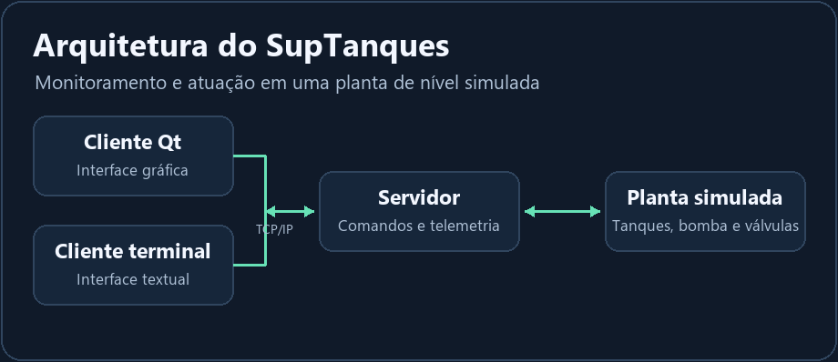

# SupTanques

**C++17 · Qt · TCP/IP · Simulação de processos**

Sistema supervisório acadêmico em C++ para acompanhar e operar uma planta **simulada** com dois tanques. O projeto aproxima programação e Sistemas de Controle ao reunir uma simulação de processo, comunicação por sockets TCP/IP e uma interface em Qt.

  

Os clientes enviam comandos e consultam o servidor, que interage com o simulador da planta.

## Funcionalidades

- Monitora os níveis dos dois tanques, a vazão da bomba e o alarme de transbordamento.
- Permite aos administradores ajustar a bomba e comandar as válvulas. Usuários visualizadores acompanham o estado da planta.
- Inclui servidor, cliente de terminal e cliente gráfico.

## Como executar

O projeto foi configurado para Windows com MinGW, Winsock (`Ws2_32`) e C++17. Para compilar, obtenha a biblioteca didática **MySocket** da disciplina, ausente no ZIP, e coloque `mysocket.h` e `mysocket.cpp` na pasta `MySocket`, ao lado da pasta deste repositório.

| Componente | Arquivo de projeto | Ferramenta |
| --- | --- | --- |
| Servidor | `SupServidor.cbp` | Code::Blocks |
| Cliente de terminal | `SupCliente.cbp` | Code::Blocks |
| Cliente gráfico | `SupCliente.pro` | Qt Creator com Qt Widgets |

No servidor, cadastre um usuário (opção `22`) e inicie a simulação (opção `0`). Para testar no mesmo computador, conecte o cliente a `127.0.0.1`, na porta `23456`. Use credenciais de teste em ambiente local.

## Créditos

Projeto de C++ da UFRN proposto pelo professor Adelardo Adelino Dantas de Medeiros. A classe `Tanks` em `tanques.*` simula a planta e foi disponibilizada pela disciplina.
